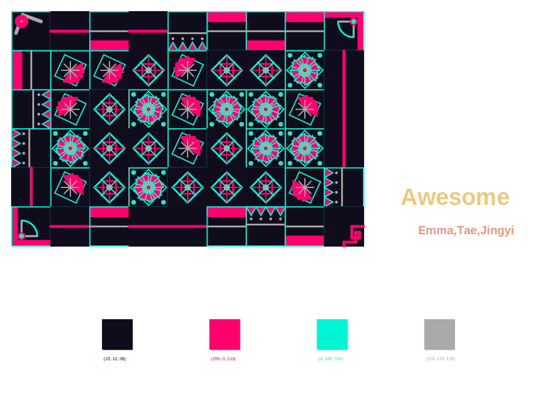

# Generative Poster Project Team Awesome



**Created by:** Jingyi, Emma, and Tae  
**Course:** Creative Coding, Pratt Institute  
**Semester:** Fall 2026

## About the Project

This project is used to create an interactive poster design where users can customize an array of different colorful tiles. It uses color palette and designs from all three creators to make a unified composition.

## The Interface

Users can modify poster title, authorship, color palette, and how many rows and columns of tiles the poster uses.

## Meet the Designers

- **Jingyi:** Positioned and rendered the poster text, built the color swatch display with RGB values, and managed performance for fast rendering. Color palette and tiles were inspired by traditional Chinese elements and colors. 
- **Emma:** Designed the canvas configuration, tile size, and controlling the generative behavior. My tile designs were initially inspire by my color palette I had chosen. I wanted my colors to be bright, fun and feel almost tropical. Then from there I wanted my design to match the color palette and have some floral and nature motifs. 
- **Tae:** Designed user-facing prompts with while-loops and created generator to make a randomized palette. Color palette and tiles were inspired by early 2000's technology advertisements. 

## Try it yourself

Copy this code into a Colab Notebook.

```python
!git clone https://github.com/yjy9098/GROUP-PROJECT-Generative-Poster-Team-Awesome
%cd GROUP-PROJECT-Generative-Poster-Team-Awesome
!pip install -r requirements.txt
from project import generate_poster
generate_poster()
(t.hideturtle())
```

Click the button below to run our poster generator:

[](https://colab.research.google.com/drive/1I4BGPpbicWTfXsBIvQOUT__aYjnlwuQi?usp=sharing)

## Code Explanation
The user is given a place to input their name and title of 

### How to Use

1. Open the notebook in Google Colab.
2. Run the setup cells to download the project code and install the required libraries.
3. Run the cell that calls the function and prompts the user to choose a title, grid dimensions, and color palette.
4. Your own poster will be saved as poster.svg!

## Files

- `project.py` – Main poster-generation program.
- `TileFunctions.py` – Collection of custom tile-drawing functions.
- `PaletteOptions.py` – Available color palettes.
- `requirements.txt` – Required Python libraries.
- `example_poster.svg` – Scalable vector version of an example final poster image.

